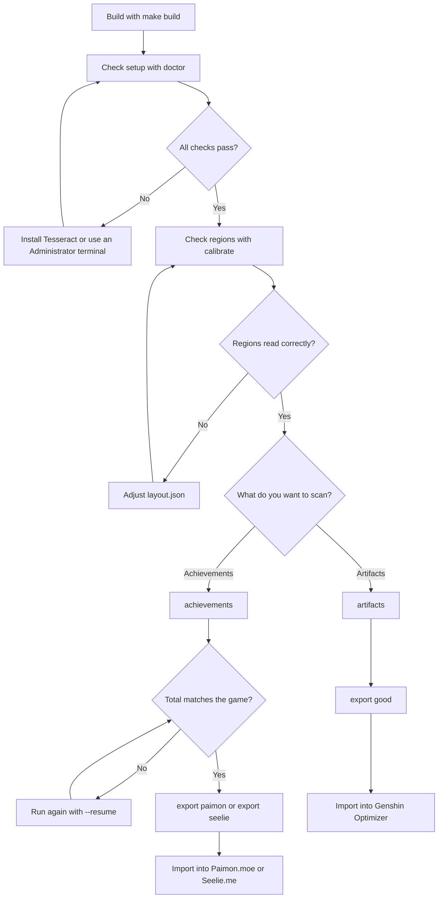
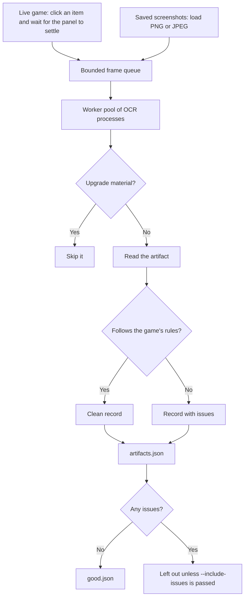
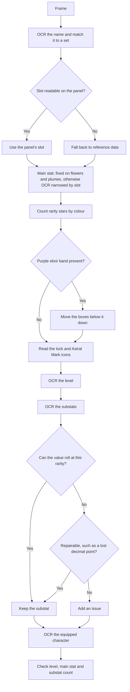
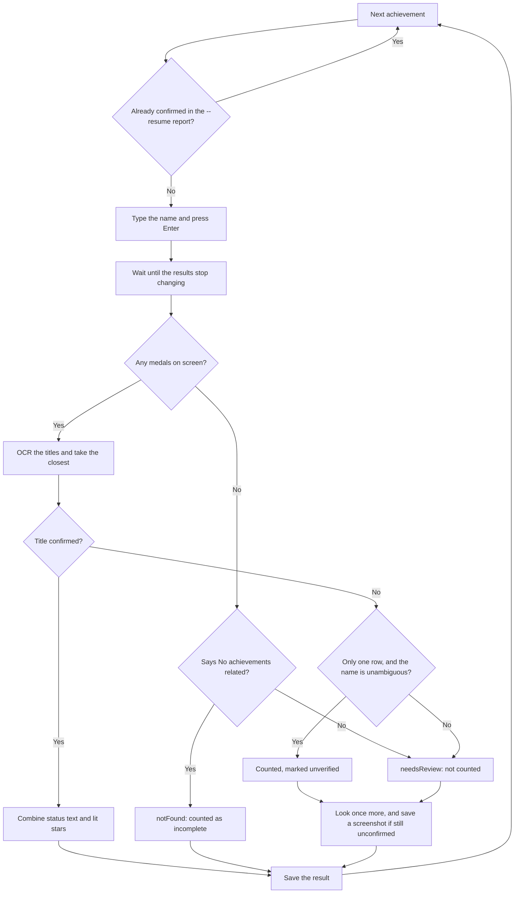
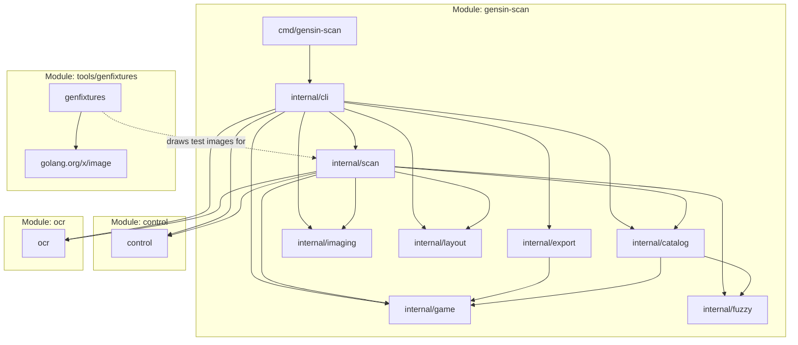
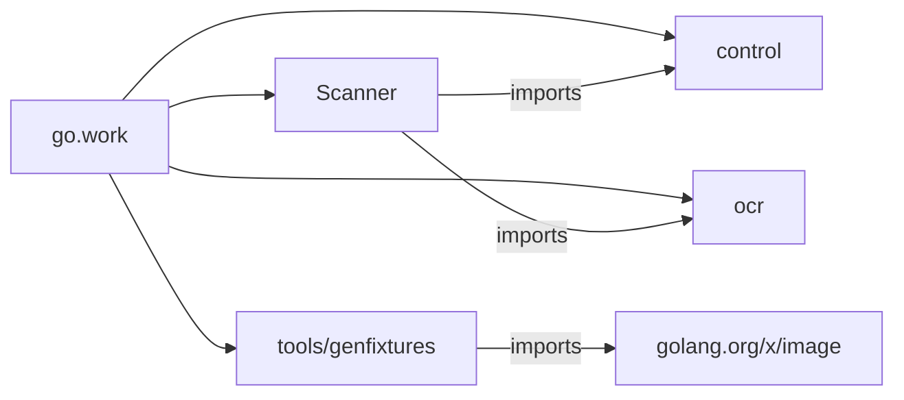

# gensin-scan

`gensin-scan` is a Windows tool that reads your Genshin Impact **artifacts** and **achievements** from the game's screen using OCR, then exports them for tools like [Genshin Optimizer](https://frzyc.github.io/genshin-optimizer/), [Paimon.moe](https://paimon.moe) and [Seelie.me](https://seelie.me).

- **Pure Go standard library.** The scanner and its libraries have no third-party modules and no cgo. Win32 is called through `syscall`, and OCR runs through the Tesseract program.
- **Strongly typed.** Slots, stats, rarities and IDs are distinct types that reject invalid values, including when saved reports are read back.
- **Works from screenshots too.** The same pipeline scans saved images, so you can review results or scan with no automation at all.
- **Validates what it reads.** Substat values are checked against the values the game can actually roll, which also repairs common OCR mistakes like a lost decimal point.
- **Stops safely.** Alt-Tab away from the game and scanning stops, with progress saved.

> [!IMPORTANT]
> **Run `calibrate` before your first scan**, especially on a window that isn't 16:9. The default coordinates have been checked on one real 1920×1080 client. See [Project status](#project-status) for what has and hasn't been tested.

> [!WARNING]
> Live scanning sends simulated mouse and keyboard input to the game. It never touches game memory or files, but HoYoverse's terms restrict third-party automation, so use it at your own risk. Scanning your own screenshots with `--from-dir` sends no input at all.

## Contents

- [Project status](#project-status)
- [Requirements](#requirements)
- [Quick start](#quick-start)
- [Example commands](#example-commands)
- [Calibrating](#calibrating)
- [Commands](#commands)
- [Output files](#output-files)
- [How it works](#how-it-works)
- [Workspace](#workspace)
- [Development](#development)
- [Troubleshooting](#troubleshooting)
- [Known limitations](#known-limitations)
- [Acknowledgements](#acknowledgements)

## Project status

| Area                                    | Status                          | How it was checked                                                                                                                                                                                                |
| --------------------------------------- | ------------------------------- | ----------------------------------------------------------------------------------------------------------------------------------------------------------------------------------------------------------------- |
| Artifact reading                        | Tested on the real game         | A full scan of a 748-item inventory on a 1920×1080 client exported 381 artifacts with no issues. A sample of frames was compared by eye with the game; the rest weren't checked individually                      |
| Inventory traversal                     | Tested on the real game         | The first 384 items of that scan had no duplicates or ordering breaks. Items after that were below the rarity filter, so they weren't kept for checking. A simulated grid covers other window and inventory sizes |
| Achievement scan                        | Tested on the real game         | A full live scan found 495 completed stages, matching the game's own total exactly                                                                                                                                |
| Exports                                 | Partly tested                   | Field names and set keys compared against Genshin Optimizer's schema and key list. Imports into the sites aren't covered by the test suite                                                                        |
| Reference data                          | Tested                          | 297 of 299 artifact pieces match Genshin Optimizer's data; the other 2 have aliases                                                                                                                               |
| Win32 capture and input                 | Tested on the real game         | Used by the live scans above, and `make test` runs the capture and input structure tests                                                                                                                          |
| **Other resolutions and aspect ratios** | **Not tested on the real game** | Coordinates scale, but only 1920×1080 frames have been seen                                                                                                                                                       |

## Requirements

| Requirement                                                              | Notes                                                                                             |
| ------------------------------------------------------------------------ | ------------------------------------------------------------------------------------------------- |
| Windows 10 or 11                                                         | The only supported platform                                                                       |
| [Tesseract OCR](https://github.com/tesseract-ocr/tesseract) 4.1 or newer | On Windows: `winget install tesseract-ocr.tesseract`                                              |
| Go 1.27 and Make                                                         | To build. Make runs from WSL, which cross-compiles for Windows and runs the tests through interop |
| Game language: English                                                   | Names are matched against English data                                                            |
| Game window at least 1280 wide, no wider than 16:9                       | Windowed or borderless. Exclusive fullscreen captures as black                                    |
| No colour filters                                                        | Night Light, ReShade, f.lux and similar will break star detection, which relies on exact colours  |

An **Administrator terminal** is required for live scans. The game runs elevated, and Windows silently discards input sent to it from unelevated programs.

## Quick start



**1. Build** from WSL:

```sh
make build                                 # produces bin/gensin-scan.exe
cp bin/gensin-scan.exe /mnt/c/Users/<you>/ # copy it somewhere Windows can run it
```

**2. Check your setup** from an **Administrator** PowerShell on Windows:

```powershell
cd $HOME
.\gensin-scan.exe doctor
```

**3. Calibrate.** Open your inventory on the Artifacts tab, select an artifact, then:

```powershell
.\gensin-scan.exe calibrate
```

Follow [Calibrating](#calibrating) until each region reads correctly.

**4. Scan artifacts.** With the Artifacts tab still open:

```powershell
.\gensin-scan.exe artifacts --traveler-name "YourName"
.\gensin-scan.exe export good
```

Then import `good.json` into Genshin Optimizer.

**5. Scan achievements.** Open the Achievements screen, then:

```powershell
.\gensin-scan.exe achievements
.\gensin-scan.exe export paimon
.\gensin-scan.exe export seelie
```

This types a search for each of about 1,600 achievements and takes a while, so try `--limit 10` first and compare the results with the game. If it gets interrupted, continue with `--resume achievements.json`.

## Example commands

These use PowerShell.

**Check your setup:**

```powershell
.\gensin-scan.exe doctor
.\gensin-scan.exe version
```

**Try a small scan first**, then compare the result with the game:

```powershell
.\gensin-scan.exe artifacts --limit 60 --save-frames frames
.\gensin-scan.exe achievements --limit 10
```

**Scan everything and export it:**

```powershell
.\gensin-scan.exe artifacts --traveler-name "YourName"
.\gensin-scan.exe export good

.\gensin-scan.exe achievements --save-failures failures
.\gensin-scan.exe export paimon
.\gensin-scan.exe export seelie
```

**Include 3-star artifacts, or only 5-star ones:**

```powershell
.\gensin-scan.exe artifacts --min-rarity 3
.\gensin-scan.exe artifacts --min-rarity 5
```

**Continue an interrupted achievement scan:**

```powershell
.\gensin-scan.exe achievements --resume achievements.json
```

**Keep your other data on a tracking site.** Export from the site first, then merge:

```powershell
.\gensin-scan.exe export paimon --merge my-paimon-export.json -o paimon-import.json
.\gensin-scan.exe export seelie --merge my-seelie-export.json -o seelie-import.json
```

**Scan saved screenshots**, which sends no input to the game:

```powershell
.\gensin-scan.exe artifacts --from-dir .\frames -o artifacts-rescan.json
.\gensin-scan.exe achievements --from-dir .\screenshots -o achievements-rescan.json
```

**Export artifacts that have scan issues too.** Check them first, because they may have wrong or missing values:

```powershell
.\gensin-scan.exe export good --include-issues -i artifacts.json -o good-all.json
```

**Calibrate from the game or a screenshot:**

```powershell
.\gensin-scan.exe capture -o shot.png
.\gensin-scan.exe calibrate --image shot.png
.\gensin-scan.exe calibrate --screen achievements --image shot.png -o achievements-boxes.png
.\gensin-scan.exe artifacts --limit 10 --layout layout.json
```

**Slow down for a slower PC, or use more OCR processes:**

```powershell
.\gensin-scan.exe artifacts --pace 2 --countdown 10s
.\gensin-scan.exe artifacts --from-dir .\frames --workers 4
```

**Use a specific Tesseract or a custom OCR model:**

```powershell
.\gensin-scan.exe doctor --tesseract "C:\Tools\Tesseract-OCR\tesseract.exe"
.\gensin-scan.exe artifacts --tessdata .\tessdata --lang genshin_eng
```

**Update names after a game patch:**

```powershell
.\gensin-scan.exe update-data
```

**Develop from WSL:**

```sh
make check            # format check, vet, stdlib-only check and tests
make build            # build bin/gensin-scan.exe
make test             # run every test on Windows through interop
make update-data      # refresh the embedded reference data
make fixtures         # redraw the OCR test images
make tidy             # tidy every module in the workspace

GOOS=windows go test ./... ./control/... ./ocr/...  # test every module without make
GOOS=windows go test ./ocr/...                      # test one library
```

## Calibrating

Game patches move things around, so all coordinates live in an editable layout.

```powershell
.\gensin-scan.exe calibrate                        # from the live game
.\gensin-scan.exe calibrate --screen achievements  # with a search result showing
.\gensin-scan.exe calibrate --image shot.png       # from a saved screenshot
```

This prints what OCR reads in each region and writes `calibration.png` with the regions outlined:

```text
itemCount    (1030,20)-(1205,45)      "Artifacts 123/2100"
name         (887,81)-(1154,116)      "Crown of the Befallen"
slot         (889,120)-(1059,144)     "Circlet of Logos"
mainStat     (889,180)-(1059,200)     "CRIT Rate"
rarity       (888,236)-(1002,260)     ""
level        (893,287)-(927,304)      "+20"
substats     (902,315)-(1198,420)     "CRIT DMG+20.2% | ATK+9.9% | HP+299 | DEF+23"
equipped     (1008,610)-(1198,635)    "Hu Tao"
```

`rarity`, `lockIcon`, `astralIcon` and `stars[n]` are read by colour, so unreadable or empty text there is expected. Check in the image that their boxes are in the right place. The red dots on the inventory image mark where the scanner will click.

On the achievements screen, rows are found from their gold medals, so boxes appear only for rows that were detected. Their `top` and `bottom` values are offsets from the middle of the medal.

To change a region:

```powershell
.\gensin-scan.exe calibrate --print-layout > layout.json
# Edit layout.json, then check it and use it for scans:
.\gensin-scan.exe calibrate --layout layout.json
.\gensin-scan.exe artifacts --layout layout.json
```

> [!NOTE]
> PowerShell 5's `>` writes UTF-16, which won't parse. In that version use `| Out-File -Encoding ascii layout.json`.

**Coordinate rules.** Values are for a window 1280 pixels wide and scale automatically. Negative values measure from the right or bottom edge, so `"left": -393` on a 1920-wide window means 590 pixels from the right edge (393 × 1.5). The easiest way to get numbers is to take a 1280×720 screenshot and read pixel positions from it. A layout file only needs the fields it changes.

## Commands

Run `gensin-scan <command> -h` for full details. Exit codes: `0` success, `1` failure or early stop, `2` invalid usage.

### `artifacts`

| Flag              | Default          | Purpose                                                                       |
| ----------------- | ---------------- | ----------------------------------------------------------------------------- |
| `-o`              | `artifacts.json` | Report file                                                                   |
| `--from-dir`      |                  | Scan screenshots in this directory instead of the live game                   |
| `--save-frames`   |                  | Save each frame, to re-scan later without the game                            |
| `--traveler-name` |                  | Your in-game name, so equipped artifacts resolve to `Traveler`                |
| `--min-rarity`    | `4`              | Leave out lower rarities. Unknown rarities are kept, so failures stay visible |
| `--limit`         | `0` (all)        | Stop after this many items                                                    |
| `--count`         | `0` (read it)    | Set the item count, if OCR can't read it                                      |
| `--workers`       | CPUs − 1         | Parallel OCR processes                                                        |
| `--pace`          | `1`              | Multiplier for delays. Raise it if clicks get missed                          |
| `--countdown`     | `5s`             | Delay before a live scan starts                                               |

Tip: run a real scan once with `--save-frames frames`. Then you can experiment with `--from-dir frames` and layouts without touching the game.

### `achievements`

Takes `-o`, `--from-dir`, `--limit`, `--pace` and `--countdown` as above, plus:

- `--resume <report>` keeps results whose title was confirmed and searches everything else again.
- `--save-failures <dir>` saves a screenshot of each result that couldn't be confirmed.

A live scan also reads the game's own "Achievements completed" total and prints it beside the scan's count, as a cross-check.

- **Live mode** types each achievement's name in the search box, identifies the result by reading its title, and counts its stars.
- **Offline mode** (`--from-dir`) reads every full row visible in your screenshots and looks up each title, so scrolled lists work as well as search results.

Searches match substrings, so some names return several achievements, and the row with the closest title is used. If no row can be confirmed, the entry gets `needsReview` and isn't counted as complete, and `--resume` searches it again.

The game's search doesn't list every achievement, and shows "No achievements related to..." for some. Those get `notFound` and aren't counted as complete. On the one account tested, about 780 achievements behaved this way, and the scan still matched the game's completed total exactly. If your totals differ, a completed achievement may be among them.

Completion comes from two signals. "Completed" means every stage is done, while progress such as `1/30` means at least one stage isn't. Otherwise the number of lit stars on the medal decides.

### `export`

| Command         | Reads               | Writes        | Extra flags                                         |
| --------------- | ------------------- | ------------- | --------------------------------------------------- |
| `export good`   | `artifacts.json`    | `good.json`   | `--include-issues` keeps artifacts with scan issues |
| `export paimon` | `achievements.json` | `paimon.json` | `--merge file`                                      |
| `export seelie` | `achievements.json` | `seelie.json` | `--merge file`                                      |

Use `-i` and `-o` to change the paths. `--merge` takes the site's own export and keeps everything in it, **except achievements, which are replaced**.

Artifacts with scan issues are left out by default, because an otherwise valid artifact could be missing a substat. Artifacts that break the game's rules are never exported, even with `--include-issues`, because importers would silently fill bad fields with defaults.

### Setup commands

| Command                | Purpose                                                                                                                                 |
| ---------------------- | --------------------------------------------------------------------------------------------------------------------------------------- |
| `doctor`               | Checks Tesseract, language data, layout, reference data, Administrator rights and the game window                                       |
| `calibrate`            | See [Calibrating](#calibrating)                                                                                                         |
| `capture -o file`      | Saves a screenshot of the game window. Doesn't need Administrator rights                                                                |
| `update-data [-o dir]` | Downloads current names to your user cache, which then overrides the embedded data. Run it after a game patch adds sets or achievements |
| `version`              | Prints the version                                                                                                                      |

OCR commands also accept `--tesseract`, `--tessdata`, `--lang`, `--layout` and `--data-dir`.

**Custom OCR models.** AkashaScanner ships a model trained on the game's font, which may improve accuracy over stock `eng`. Download its `genshin_eng.traineddata`, then pass `--tessdata <dir> --lang genshin_eng`. That directory replaces the default one, so it must contain every language you use.

## Output files

Reports keep everything needed to diagnose a bad read:

```json
{
  "version": 1,
  "scannedAt": "2026-11-05T17:31:00Z",
  "complete": true,
  "items": [
    {
      "index": 0,
      "source": "frames/frame-00000.png",
      "artifact": {
        "setKey": "NightOfTheSkysUnveiling",
        "setName": "Night of the Sky's Unveiling",
        "piece": "Crown of the Befallen",
        "slot": "circlet",
        "rarity": 5,
        "level": 20,
        "mainStat": "critRate_",
        "location": "HuTao",
        "substats": [{ "key": "critDMG_", "value": 20.2 }]
      },
      "corrections": ["substat \"ATK+58%\" read as atk_=5.8"],
      "raw": {
        "name": "Crown of the Befallen",
        "slot": "Circlet of Logos",
        "level": "+20",
        "substats": ["..."]
      }
    }
  ]
}
```

- `issues` lists problems that may make the entry wrong.
- `corrections` lists OCR errors that were repaired with confidence.
- `raw` is exactly what OCR read.
- `complete` is `false` if the scan stopped early. Exports warn about this.

## How it works

### The artifact pipeline

The live game and saved screenshots feed the same pipeline, so offline scans exercise the same code as live ones.



### Reading one artifact



### The achievement scan

Results take a variable time to draw, and the game's search doesn't list every achievement, so each search ends in one of three outcomes.



### Package dependencies

Each box is a Go module in the [workspace](#workspace). `control` and `ocr` depend on nothing outside the standard library, not even each other.



### Design decisions

- **The slot comes from the screen, not the data.** HoYoWiki's slot keys are scrambled for its 8 newest sets, while its `position` field is correct. The scanner reads the slot printed on the panel and only falls back to `position`.
- **Main stats are narrowed by slot.** Only stats that can exist on that slot are candidates, so `ATK` on sands can only mean ATK%.
- **Substats are cross-checked.** All reachable roll sums are computed per rarity. `CRIT Rate+39%` can't exist on a 5-star, while `3.9%` can, so the lost decimal point gets repaired. This also tells flat stats from percent stats.
- **Darkest channel, not luminance.** Main stat labels are grey on a saturated banner, with similar brightness. The darkest colour channel separates them, which fixed the misread labels on real frames.
- **Elixir artifacts shift the panel.** A purple band moves the level, substats and icons down, so it's detected by colour and the boxes move with it.
- **Substat counts are checked.** A 5-star at +20 must have four substats, counting unactivated ones, so a lost line becomes an issue instead of silently wrong data.
- **Searches wait for results.** Results take a variable time to draw, so a live scan waits until rows are showing and two captures in a row match, then looks once more if the result still can't be confirmed.
- **Frames wait for the panel to settle.** The panel fades between items, so the scanner captures until two frames in a row match.
- **Materials end the walk.** The inventory's item count can include upgrade materials, which sort after the artifacts. When a screen holds only materials, the scan finishes normally.
- **Failed scans keep their progress.** Whatever stops a scan, the results so far are saved with `complete: false`. A failure before anything was read leaves an earlier report untouched.
- **Blank regions skip OCR.** Tesseract invents text when shown an empty, contrast-stretched region, which could assign an unequipped artifact to a random character.
- **Input is focus-gated.** Each input call first checks that the game is the foreground window, so keystrokes can't land in another application.

### Project layout

Each package has one job, and each file within it covers one topic. Everything below is in the root module unless marked otherwise.

```text
cmd/gensin-scan/        Entry point
internal/cli/           One file per command, plus engine.go for shared OCR setup
internal/game/          Domain types and rules: slot, stat, rarity, artifact, rolls
internal/scan/
    artifact_*.go       Parsing the artifact panel into a record
    substat.go          Parsing and repairing substat lines
    inventory_walker.go Starting a live inventory scan
    grid_run.go         Clicking through the item grid
    frames.go           Saved screenshots as a frame source
    pipeline.go         The worker pool that analyzes frames
    achievement_*.go    Reading results, live scans and offline scans
    reader.go           OCR on regions of one frame
    report.go           Saving and loading reports
    regions.go          Named regions for calibration
internal/layout/        Screen coordinates, scaling and JSON overrides
internal/imaging/
    preprocess.go       Preparing crops for OCR
    blobs.go            Finding stars by colour
    spans.go            Finding achievement rows by medal
    sample.go           Average colours and frame fingerprints
    io.go, draw.go      Loading, saving and drawing
internal/fuzzy/         Levenshtein matching with generics
internal/catalog/
    catalog.go          Reference data types
    match.go            Fuzzy lookups
    storage.go          Embedded snapshot and cached files
    fetch*.go           Downloading from HoYoWiki and Paimon.moe
internal/export/        GOOD, Paimon.moe and Seelie.me formats
control/                Module: game window, capture and input
    control_windows.go  The Game interface
    window_windows.go   Finding and focusing the game window
    capture_windows.go  Screen capture
    input_windows.go    Mouse and keyboard input
    win32_windows.go    Win32 definitions
ocr/                    Module: Recognizer interface and Tesseract implementation
tools/genfixtures/      Module: draws the OCR test images
go.work                 Ties the four modules together
```

## Workspace

The repository is a [Go workspace](https://go.dev/doc/tutorial/workspaces) of four modules, tied together by `go.work`:

| Module        | Path                 | Purpose                                        | Dependencies         |
| ------------- | -------------------- | ---------------------------------------------- | -------------------- |
| Scanner       | `.`                  | Parsing, reports, exports and the command line | `control`, `ocr`     |
| `control`     | `control/`           | Finding the game window, capture and input     | None                 |
| `ocr`         | `ocr/`               | Running Tesseract behind a small interface     | None                 |
| `genfixtures` | `tools/genfixtures/` | Drawing the OCR test images                    | `golang.org/x/image` |



Things worth knowing:

- **`./...` stops at module boundaries.** From the root it only covers the scanner, so use the `make` targets, or list the modules: `GOOS=windows go test ./... ./control/... ./ocr/...`.
- **Everything targets Windows.** The `control` package only exists there, so the scanner won't build for anything else. From WSL, set `GOOS=windows` when running `go` directly; the `make` targets already do. For editor support in WSL, give your Go tools the same setting, such as `"go.toolsEnvVars": { "GOOS": "windows" }` in VS Code.
- **The scanner builds without the network.** Only running `genfixtures` downloads its dependency, even though it's in the workspace.
- **The root `go.mod` also has `replace` lines.** `go mod tidy` and `GOWORK=off` ignore `go.work`, so these keep both working without published versions. `make tidy` tidies every module.

## Development

Run `make` to list all targets. The main ones:

| Target             | Purpose                                                                                |
| ------------------ | -------------------------------------------------------------------------------------- |
| `make check`       | Format check, vet, stdlib-only check, tests                                            |
| `make build`       | Build `bin/gensin-scan.exe`                                                            |
| `make test`        | Run every test on Windows through interop. Real-OCR tests skip if Tesseract is missing |
| `make cover`       | Run tests and print total coverage                                                     |
| `make update-data` | Refresh the data embedded in the binary                                                |
| `make fixtures`    | Regenerate OCR test images                                                             |
| `make tidy`        | Tidy every module's `go.mod`                                                           |

Tests find Tesseract the same way the scanner does. Set `GENSIN_TESSERACT` to the path of a `tesseract.exe` to use a specific one, adding it to `WSLENV` when running from WSL.

The images in `internal/scan/testdata` are **synthetic mock-ups** drawn by `tools/genfixtures` with a generic font, modelled on real screens. They contain no game art and guard the pipeline's behaviour, but they don't show that the layout matches the current game. Real frames show your UID and aren't committed; to recheck after a patch, scan frames saved with `--save-frames`.

`tools/genfixtures` is its own module because drawing text needs `golang.org/x/image`, as the standard library has no font rendering. That keeps the scanner dependency-free, which `make deps-check` enforces, and nothing from it ends up in the binary.

## Troubleshooting

| Symptom                                       | Likely cause and fix                                                                                                  |
| --------------------------------------------- | --------------------------------------------------------------------------------------------------------------------- |
| `the game runs as Administrator...`           | Open the terminal with _Run as administrator_                                                                         |
| `cannot read the item count`                  | Wrong tab open, or the `itemCount` box is off. Run `calibrate`, or pass `--count`                                     |
| `captured frame is entirely black`            | Switch the game to windowed or borderless                                                                             |
| `aspect ratios wider than 16:9`               | Set the game to a 16:9 resolution or narrower                                                                         |
| Scan stops with `lost focus`                  | Something took focus, such as a notification. Fullscreen-capable notifications can be silenced with Focus Assist      |
| Many `identical to the previous frame` issues | Clicks arrive too quickly or are being blocked. Raise `--pace`, and check that you're using an Administrator terminal |
| `no rarity stars found` on everything         | The `rarity` box is off, or a colour filter is active                                                                 |
| `unrecognized artifact name`                  | Run `update-data` for new sets, or the `name` box is off                                                              |
| Wrong items after scrolling                   | Your scroll distance differs. Adjust `inventory.grid.scrollTicksPerRow`                                               |
| Most achievements `unverified`                | The `title` box is off. Run `calibrate --screen achievements`                                                         |
| `tesseract not found`                         | Install it, or pass `--tesseract "C:\path\to\tesseract.exe"`                                                          |

## Known limitations

- **The optional `totalRolls` GOOD field isn't filled in.**
- **`notFound` achievements can't be confirmed individually.** They're treated as incomplete, so the printed total is the check that nothing was missed.
- **Long result lists are only partly read.** Only rows visible without scrolling are checked. A full name usually narrows results enough, and anything not found gets `needsReview`.
- **Only artifacts and achievements are scanned**, not weapons or characters. The artifact `location` field still identifies who has each piece equipped.
- **Manekin, Manekina and characters newer than Genshin Optimizer's list** get keys it doesn't recognize, so it should import those artifacts as unequipped.
- **Windows only**, and English only.
- **Achievements are checked by searching one at a time**, which is slow but makes attribution much more reliable than reading a scrolling list.

## Acknowledgements

- [AkashaScanner](https://github.com/xenesty/AkashaScanner) (MIT) inspired this project's overall approach. This is an independent Go implementation, though it reuses that project's screen coordinates, star colours and substat roll values as a starting point.
- [Genshin Optimizer](https://github.com/frzyc/genshin-optimizer) defines the GOOD format, and its data was used to verify the catalog.
- [Paimon.moe](https://github.com/MadeBaruna/paimon-moe) supplies achievement data, and HoYoWiki supplies artifact and character names.
- [Tesseract](https://github.com/tesseract-ocr/tesseract) performs the OCR.

Not affiliated with or endorsed by HoYoverse. Genshin Impact is a trademark of HoYoverse.
